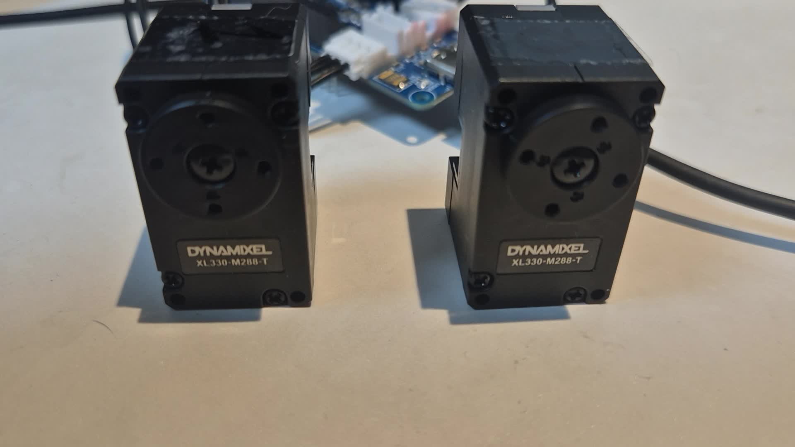

# OpenRB-150 기반 2륜 로봇 자동차

**현재 단계: 두 모터의 속도 제어·정역 회전과 자동차 조작 명령의 무부하 시험**  
작성자: 최준영 · 기록 기준: 2026년 10월 31일

OpenRB-150 한 개와 XL330-M288-T 두 개를 연결해, 컴퓨터의 문자 명령으로 각 모터를 선택하거나 함께 움직이는 기초 제어를 구현했습니다. 최종 목표는 스마트폰으로 조종하는 2륜 로봇 자동차입니다.

철학 전공 이후 로봇 분야로 진로를 넓히면서, 실제 부품 연결과 코드 업로드·통신·동작 시험을 진행하고 있습니다. 위치 제어 실습에 이어, 속도 제어 모드에서 양방향 회전과 자동차 조작 명령의 모터 조합을 시험했습니다.

## 최근 실습 — 2026-10-31

- [실습 결과와 관찰 범위](docs/2026-10-31-velocity-test.md)
- [명령별 실습 영상 9편](docs/media/2026-10-31/README.md)
- [속도 제어 코드](firmware/two_motor_velocity_test/two_motor_velocity_test.ino) · [실행 안내](docs/velocity-control.md)

영상에서 추출한 실습 장면입니다. 이번 결과는 **바퀴·차체를 장착하기 전의 모터 시험**입니다. 실제 전진 거리·회전각·주행 성능은 아직 측정하지 않았습니다.

## 구현 결과

| 기능 | 현재 상태 | 근거 |
| --- | --- | --- |
| ID 1·2 통신과 모델 1200 확인 | 확인 | [초기 검색 기록](logs/id-scan-observed.txt), [최근 p 명령 영상](docs/media/2026-10-31/README.md) |
| 개별·동시 위치 이동 | 동작 확인 | 초기 `1`·`2`·`b` 실습과 자동 종료 보고 |
| 속도 제어 모드의 개별 정역 회전 | 실습 완료 보고·영상 확보 | `1`·`2`·`3`·`4` 명령별 영상 |
| 전진·후진·좌우 회전 명령의 모터 조합 | 무부하 시험 완료 보고·영상 확보 | `w`·`x`·`a`·`d` 명령별 영상 |
| 약 2초 자동 종료 | 출력 확인 | 영상의 `AUTO_STOP` 안내. 정밀 시간 측정은 미실시 |
| 종료 후 토크 해제 응답 | 출력 확인 | 영상에 `TORQUE_OFF_CONFIRMED` 안내 보관 |
| `s`로 동작 중 중단 | 코드 구현 | 해당 상황을 판독할 수 있는 별도 영상·전체 로그 추가 예정 |
| 차체·바퀴·외부 전원·스마트폰 조종 | 다음 단계 | [개발 계획](docs/roadmap.md) |

세부 근거와 남은 시험은 [시험 결과](docs/test-results.md)에 적었습니다. 모터 동작 확인과 실제 자동차 주행·정량 성능 확인은 구분해 기록합니다.

## 실행할 코드 선택

| 코드 | 용도 | 안내 |
| --- | --- | --- |
| [two_motor_velocity_test.ino](firmware/two_motor_velocity_test/two_motor_velocity_test.ino) | 최근 속도 제어·자동차 명령 조합 시험 | [속도 제어 실습 안내](docs/velocity-control.md) |
| [two_motor_usb_test.ino](firmware/two_motor_usb_test/two_motor_usb_test.ino) | 초기 작은 각도 이동·복귀 시험 | [초기 환경 구성과 실행](docs/setup.md) |
| [set_second_motor_id.ino](firmware/set_second_motor_id/set_second_motor_id.ino) | 새 두 번째 모터의 ID를 2로 설정 | 해당 모터 한 개만 연결해서 사용 |

ID가 이미 `1`, `2`이면 다시 변경하지 않습니다. Arduino IDE에서 목적에 맞는 스케치를 **별도로 열고 업로드**합니다. 두 실습 코드는 제어 모드와 명령이 다릅니다.

### 최근 속도 제어 실습

보드는 **OpenRB-150**, 포트는 연결된 보드, 시리얼 모니터는 **115200 baud**로 선택합니다. 모터 통신 설정은 57600bps, Protocol 2.0입니다. 처음에는 바퀴·부하 없이 시험합니다.

| 입력 | 동작 |
| --- | --- |
| `p` | 두 모터의 모델·설정 확인, 오류 해결 후 준비 |
| `1` / `3` | ID 1의 +방향 / -방향 회전 |
| `2` / `4` | ID 2의 +방향 / -방향 회전 |
| `w` / `x` | 전진 / 후진에 사용할 두 모터 회전 조합 |
| `a` / `d` | 좌회전 / 우회전에 사용할 한 모터 회전 조합 |
| `s` | 두 모터에 속도 0과 토크 해제 요청 |
| `h` | 명령 안내 출력 |

각 구동 명령은 약 2초 뒤 자동 종료합니다. 기본 목표는 약 8rpm이며, 실제 속도·각도 측정값은 아닙니다. ID 1을 왼쪽, ID 2를 오른쪽으로 가정하고 전진 부호를 각각 `+1`, `-1`로 설정했습니다. 조립 후에는 바퀴를 띄운 상태에서 실제 전진 방향을 다시 확인합니다.

토크 해제는 모터가 힘을 내는 제어를 끄는 동작입니다. 전원 차단이나 기계적 제동을 뜻하지 않습니다. 전류·출력 설정, 오류 처리와 시험 순서는 [실행 안내](docs/velocity-control.md)를 참고합니다.

## 단계별 기록

| 기록 | 내용 |
| --- | --- |
| 초기 실습 — 2026-10-25 정리 | ID 구분, 두 모터 위치 제어, 자동 종료, 연결 사진과 첫 실습 영상 |
| [2026-10-31](docs/2026-10-31-velocity-test.md) | 속도 제어, 개별 정역 회전, `p` 확인, 자동차 명령 조합 영상 9편 |

같은 자동차 제작 과정은 이 저장소에 이어서 기록합니다. 새 제어 코드는 별도 스케치 폴더에 보관하고, 실습 기록과 영상은 날짜로 구분합니다.

## 사용 장비와 전원

| 항목 | 구성 |
| --- | --- |
| 제어 보드 | OpenRB-150 × 1 |
| 모터 | DYNAMIXEL XL330-M288-T × 2 |
| 연결 | 모터용 3핀 케이블, 데이터 통신용 USB 케이블 |
| 개발 환경 | Ubuntu, Arduino IDE, Dynamixel2Arduino |
| 이번 시험 | USB 연결, 바퀴·차체 미장착 |

ID는 모터 내부의 통신 주소이며 보드 단자의 위치나 코드 변수명이 아닙니다. 전원을 끈 상태에서 케이블을 연결·분리합니다. OpenRB-150의 USB 전류 제한과 XL330의 권장 전압을 고려해, 차체에 부하를 걸어 주행하기 전에는 외부 5V 전원과 점퍼 구성을 확인할 계획입니다.

## 초기 연결 사진과 영상

[두 모터의 통신 응답 사진](docs/media/wiring-two-motors-2.jpg) · [첫 실습 영상 다운로드 — 약 18초, 4.37MB](https://github.com/immanuelkant616-stack/openrb-2wd-robot/raw/refs/heads/main/docs/media/motor-control-demo.mp4)

이전 자료를 함께 보관해 위치 제어에서 속도 제어로 진행한 과정을 확인할 수 있도록 했습니다. 전체 자료 목록은 [사진·영상 기록 안내](docs/media/README.md)에 있습니다.

## 문제 해결과 배운 점

| 문제·전환 | 대응·배운 점 |
| --- | --- |
| 보드·포트 인식과 업로드 문제 | 데이터 케이블, 보드·포트 선택, 리셋 상태를 점검하며 업로드 |
| `reference to 'ID' is ambiguous` | 라이브러리와 충돌하는 변수명을 `MOTOR_ID` 등으로 변경 |
| 새 명령에 이전 동작이 실행됨 | 파일 열기와 실제 업로드를 구분하고 안내 문구 확인 |
| ID 설정과 구동 명령 혼동 | ID 설정용 코드와 움직임 시험용 코드를 분리 |
| 첫 모터 커넥터 분리가 어려움 | 손상 우려로 기존 케이블을 유지하는 ID 관리 대안을 모색하고, 최종 ID 1·2의 응답과 두 모터 구동을 확인 |
| 위치 제어에서 속도 제어로 전환 | 기존 전류 설정을 그대로 가정하지 않고 출력 제한·전류 감시·종료 절차 검토 |
| 동작 결과를 포트폴리오로 남기기 | 명령·코드·촬영 자료를 연결하고 정량 측정 여부 구분 |

### 커넥터 분리가 어려웠을 때의 접근

OpenRB-150에 이미 연결된 첫 번째 모터의 커넥터가 뻑뻑해 쉽게 빠지지 않았습니다. 무리하게 당기면 커넥터나 보드 단자가 손상될 수 있다고 판단해, **첫 모터의 케이블을 꽂아 둔 채 두 번째 모터를 추가하는 방법**을 모색했습니다.

모터는 꽂힌 단자 위치가 아니라 내부의 통신 주소인 ID로 구분된다는 점에 주목했습니다. 기존 모터의 ID를 임시로 `1 → 10`으로 옮겨 주소를 비운 뒤 새 모터를 추가하고, 새 모터를 `1 → 2`로 변경한 다음 기존 모터를 `10 → 1`로 되돌리는 절차를 대안으로 마련했습니다. 모터 케이블을 추가할 때는 USB 전원을 끄는 순서로 구성했습니다.

최종적으로 두 모터가 연결된 상태에서 `p` 검색으로 `ID=1 Model=1200`, `ID=2 Model=1200` 응답을 확인했습니다. 이후에는 ID를 더 변경하지 않고 구동 코드로 전환해, `b` 명령으로 두 모터가 함께 움직이고 자동 종료하는 것을 확인했습니다. 임시 ID 변경 절차의 기록 범위와 실제 확인 결과는 [상세 문제 해결 기록](docs/troubleshooting.md#5-커넥터가-잘-빠지지-않음)에 구분해 정리했습니다.

[오류 해결 기록](docs/troubleshooting.md) · [초기 위치 제어 코드 설명](docs/code-guide.md) · [코드 검증 범위](docs/verification.md)

## 직접 수행한 작업과 AI 활용

하드웨어 연결, Arduino IDE 설정, 코드 업로드, 명령 입력, 실제 동작 확인과 촬영은 직접 수행했습니다. 코드 초안·오류 해석·문서 정리에는 생성형 AI를 활용했습니다. 출력과 실제 움직임을 확인하며 다음 실습을 진행했고, 이번에는 명령별 영상을 남겨 결과를 보완했습니다.

## 참고 자료

- [ROBOTIS OpenRB-150 공식 안내](https://emanual.robotis.com/docs/en/parts/controller/openrb-150/)
- [ROBOTIS XL330-M288-T 공식 안내](https://emanual.robotis.com/docs/en/dxl/x/xl330-m288/)

