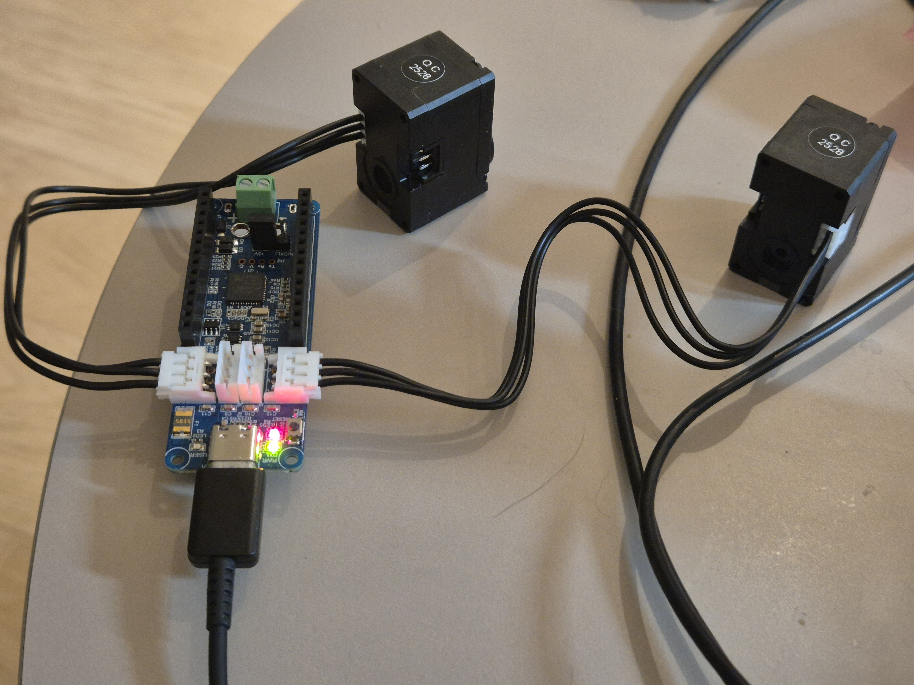
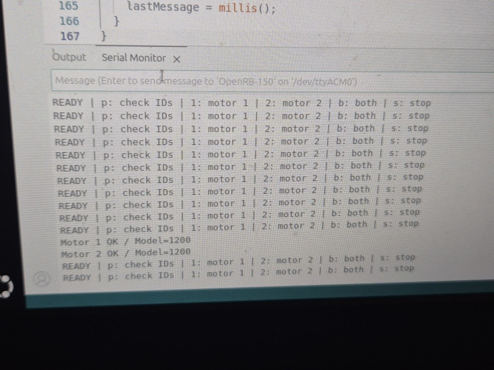

# OpenRB-150 기반 2륜 로봇 자동차

**현재 단계: XL330-M288-T 모터 두 개의 개별·동시 위치 제어**  
작성자: 최준영 · 기록 기준: 2026년 10월 25일

OpenRB-150 한 개와 XL330-M288-T 두 개를 연결해, 컴퓨터에서 입력한 문자 명령으로 각 모터를 선택하거나 함께 움직이는 기초 제어를 구현했습니다. 최종 목표는 스마트폰으로 조종하는 2륜 로봇 자동차입니다.

철학 전공 이후 로봇 분야로 진로를 넓히면서, 실제 부품을 연결하고 코드 업로드·통신·동작 시험을 수행하는 과정을 기록하고 있습니다.

## 구현 결과

| 기능 | 현재 상태 | 근거 |
| --- | --- | --- |
| 보드 업로드와 한 모터 구동 | 동작 확인 | 직접 연결·업로드 후 회전 확인 |
| 두 모터의 통신 주소 구분 | 확인 | [ID 1·2의 응답 기록](logs/id-scan-observed.txt) · [시리얼 모니터 사진](docs/media/wiring-two-motors-2.jpg) |
| 두 모터의 개별 제어 | 동작 확인 | 각 모터의 작동을 직접 확인 |
| 두 모터 함께 구동 | 동작 확인 | `b` 명령에 따른 두 모터 움직임 확인 |
| 동작 후 자동 종료 | 동작 확인 | 별도 정지 입력 없이 멈추는 것 확인 |
| `s` 명령으로 중간 중단 | 코드 구현 | 실제 중단 시험은 추가 기록 예정 |
| 연속 회전·차체 주행·스마트폰 조종 | 다음 단계 | [개발 계획](docs/roadmap.md) |

현재 결과는 작은 각도의 위치 이동 시험입니다. 실제 이동 각도의 수치, 반복 성공률, 차체 주행 성능은 아직 기록하지 않았습니다. 하드웨어 연결·통신 확인 사진과 모터 제어 실습 영상을 아래에 첨부했습니다. 자료별 설명은 [사진·영상 기록 안내](docs/media/README.md)에 정리했습니다.

## 실습 영상

[▶ 모터 제어 실습 영상 다운로드 — 약 18초 · 4.37MB](https://github.com/immanuelkant616-stack/openrb-2wd-robot/raw/refs/heads/main/docs/media/motor-control-demo.mp4)

영상 파일을 내려받은 뒤 소리를 켜서 재생해 주세요.

시리얼 모니터와 연결한 두 모터를 촬영한 실습 기록입니다. 전체 분량을 유지하면서 720p로 압축했고, 작게 녹음된 원음의 전체 음량을 보정했습니다. 주변 소리도 함께 커질 수 있습니다. 회전각·반복 정확도와 중단 명령의 결과는 별도 시험으로 기록할 예정입니다.

## 실습 사진

### 보드와 두 모터 연결

OpenRB-150 한 개에 XL330-M288-T 모터 두 개를 연결하고 USB로 전원을 공급한 구성입니다.



### 두 모터 통신 확인

시리얼 모니터에서 `Motor 1 OK / Model=1200`, `Motor 2 OK / Model=1200` 응답을 확인했습니다. 아래 사진은 두 모터의 통신 응답을 보여 줍니다.



## 사용 장비와 연결

| 항목 | 구성 |
| --- | --- |
| 제어 보드 | OpenRB-150 × 1 |
| 모터 | DYNAMIXEL XL330-M288-T × 2 |
| 케이블 | 모터 연결용 3핀 케이블 × 2, 데이터 통신용 USB 케이블 |
| 개발 환경 | Ubuntu, Arduino IDE, Dynamixel2Arduino |
| 이번 시험의 전원 | USB, 보드의 +5V 점퍼 설정 |

컴퓨터와 보드는 USB로 연결하고, 보드의 서로 다른 다이나믹셀 단자에 모터를 하나씩 연결했습니다. 모터 ID는 각각 `1`, `2`입니다. **ID는 모터 내부의 통신 주소이며, 보드 단자의 위치나 코드 변수명이 아닙니다.**

## 실행 방법

두 모터의 ID가 이미 `1`, `2`로 설정된 경우 아래 순서로 실행합니다. 자세한 설치·연결 방법은 [환경 구성과 실행 안내](docs/setup.md)에 정리했습니다.

1. Arduino IDE에서 [two_motor_usb_test.ino](firmware/two_motor_usb_test/two_motor_usb_test.ino)를 엽니다.
2. 보드를 **OpenRB-150**, 포트를 연결된 장치로 선택하고 `→`로 업로드합니다.
3. 시리얼 모니터를 **115200 baud**로 열고 아래 안내 문구를 확인합니다.

```text
READY | p: check IDs | 1: motor 1 | 2: motor 2 | b: both | s: stop
```

4. `p`로 두 모터의 응답을 확인한 뒤 `1` → 동작 종료 → `2` → 동작 종료 → `b` 순서로 시험합니다. 각 명령은 입력 후 Enter로 전송합니다.

| 입력 | 동작 |
| --- | --- |
| `p` | 두 모터의 응답 및 모델 번호 확인 |
| `1` | 1번 모터만 위치 이동 시험 |
| `2` | 2번 모터만 위치 이동 시험 |
| `b` | 두 모터를 함께 위치 이동 시험 |
| `s` | 진행 중인 시험 중단 및 두 모터의 토크 해제 요청 |

시작 명령 후 3초를 기다리고, 현재 위치에서 약 20도 이동하는 목표와 시작 위치로 복귀하는 목표를 차례로 보냅니다. 각 구간의 대기 시간이 지나면 토크를 해제합니다. 토크 해제는 모터가 힘을 내는 제어를 끄는 것으로, 보드 전원을 끄는 것과는 다릅니다.

`b`는 두 모터에 연이어 명령을 보내는 방식입니다. 목표 각도 도달과 정밀한 동시 시작을 보장하는 제어는 아직 구현하지 않았습니다. USB 시험은 부하를 달지 않은 작은 움직임을 대상으로 하며, 전류 설정과 사용 조건은 [실행 안내](docs/setup.md)에 적었습니다.

## 문제 해결과 배운 점

| 문제 | 대응 |
| --- | --- |
| 보드·포트 인식과 업로드 문제 | 데이터 케이블, 보드·포트 선택, 리셋 상태를 점검하며 업로드에 성공 |
| `reference to 'ID' is ambiguous` | 라이브러리와 충돌하는 변수명을 `MOTOR_ID` 등으로 변경 |
| 새 명령에 이전 동작이 실행됨 | 파일 열기와 업로드를 구분하고, 안내 문구로 실행 중인 스케치 확인 |
| ID 검색과 구동 명령 혼동 | ID 설정용 코드와 움직임 시험용 코드를 별도 폴더로 구분 |

자세한 원인과 확인 절차는 [오류 해결 기록](docs/troubleshooting.md), 제어 흐름은 [코드 설명](docs/code-guide.md)에 정리했습니다.

## 직접 수행한 작업과 AI 활용

하드웨어 연결, Arduino IDE 설정, 코드 업로드, 명령 입력과 실제 동작 확인은 직접 수행했습니다. 코드 초안 작성과 오류 해석에는 생성형 AI의 도움을 받았습니다. 오류 메시지·시리얼 출력·실제 움직임을 확인하면서 제시된 코드와 안내를 검토했습니다.

## 저장소 안내

| 경로 | 내용 |
| --- | --- |
| [firmware/two_motor_usb_test/](firmware/two_motor_usb_test/) | 이번에 구동을 확인한 주 실행 코드 |
| [firmware/set_second_motor_id/](firmware/set_second_motor_id/) | 두 번째 모터 한 개만 연결해서 사용하는 ID 설정 도구 |
| [docs/setup.md](docs/setup.md) | 연결, 환경 설치, 업로드, 실행 순서 |
| [docs/code-guide.md](docs/code-guide.md) | 함수와 주요 설정값 설명 |
| [docs/troubleshooting.md](docs/troubleshooting.md) | 발생한 오류와 해결 과정 |
| [docs/test-results.md](docs/test-results.md) | 확인된 결과와 추가 시험 항목 |
| [docs/verification.md](docs/verification.md) | 코드 보존·컴파일 기록과 검증 범위 |
| [docs/media/](docs/media/) | 연결·통신 확인 사진, 실습 영상과 촬영 안내 |
| [logs/](logs/) | 실제 출력 기록과 다음 시험용 기록 양식 |
| [docs/roadmap.md](docs/roadmap.md) | 연속 회전부터 스마트폰 조종까지의 계획 |

## 참고 자료

- [ROBOTIS OpenRB-150 공식 안내](https://emanual.robotis.com/docs/en/parts/controller/openrb-150/)
- [ROBOTIS XL330-M288-T 공식 안내](https://emanual.robotis.com/docs/en/dxl/x/xl330-m288/)

