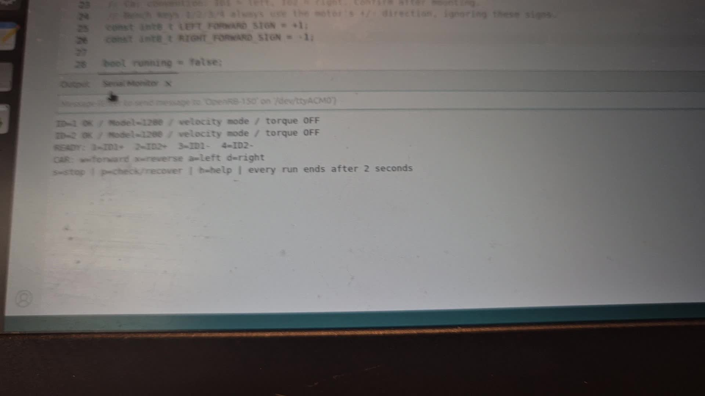

# 2026-10-31 속도 제어 실습 영상

[프로젝트 README](../../../README.md) · [실습 결과](../../2026-10-31-velocity-test.md) · [실행 안내](../../velocity-control.md)

작성자가 개별 정역 회전과 자동차 조작 명령 시험을 마치고 제공한 영상 9편입니다. 모터는 바퀴·차체 없이 시험했습니다. 아래 링크로 파일을 내려받아 재생할 수 있습니다.

| 명령 | 촬영 내용 | 영상 | 분량 | 용량 | 제공 원본 |
| --- | --- | --- | --- | --- | --- |
| 1 | ID 1 +방향 | [다운로드](https://github.com/immanuelkant616-stack/openrb-2wd-robot/raw/refs/heads/main/docs/media/2026-10-31/01-id1-positive.mp4) | 11.2초 | 2.83MB | `1000105101.mp4` |
| 2 | ID 2 +방향 | [다운로드](https://github.com/immanuelkant616-stack/openrb-2wd-robot/raw/refs/heads/main/docs/media/2026-10-31/02-id2-positive.mp4) | 8.6초 | 2.23MB | `1000105102.mp4` |
| 3 | ID 1 -방향 | [다운로드](https://github.com/immanuelkant616-stack/openrb-2wd-robot/raw/refs/heads/main/docs/media/2026-10-31/03-id1-negative.mp4) | 7.0초 | 1.61MB | `1000105103.mp4` |
| 4 | ID 2 -방향 | [다운로드](https://github.com/immanuelkant616-stack/openrb-2wd-robot/raw/refs/heads/main/docs/media/2026-10-31/04-id2-negative.mp4) | 7.9초 | 1.64MB | `1000105104.mp4` |
| p | 두 ID·모델·속도 모드 확인 | [다운로드](https://github.com/immanuelkant616-stack/openrb-2wd-robot/raw/refs/heads/main/docs/media/2026-10-31/05-id-check.mp4) | 3.8초 | 0.87MB | `1000105105.mp4` |
| w | 전진 명령의 두 모터 조합 | [다운로드](https://github.com/immanuelkant616-stack/openrb-2wd-robot/raw/refs/heads/main/docs/media/2026-10-31/06-forward-command.mp4) | 6.5초 | 1.40MB | `1000105106.mp4` |
| x | 후진 명령의 두 모터 조합 | [다운로드](https://github.com/immanuelkant616-stack/openrb-2wd-robot/raw/refs/heads/main/docs/media/2026-10-31/07-reverse-command.mp4) | 5.5초 | 1.07MB | `1000105107.mp4` |
| a | 좌회전 명령의 모터 조합 | [다운로드](https://github.com/immanuelkant616-stack/openrb-2wd-robot/raw/refs/heads/main/docs/media/2026-10-31/08-left-command.mp4) | 5.7초 | 1.17MB | `1000105108.mp4` |
| d | 우회전 명령의 모터 조합 | [다운로드](https://github.com/immanuelkant616-stack/openrb-2wd-robot/raw/refs/heads/main/docs/media/2026-10-31/09-right-command.mp4) | 5.1초 | 1.13MB | `1000105109.mp4` |

`w`·`x`·`a`·`d`는 차체의 실제 주행이 아니라 모터 조합 시험입니다. 05번은 `p` 확인 영상이며 `s` 중간 중단 영상은 아닙니다. 일부 화면의 출력은 이전 실행 기록도 포함하므로 반복 성공 횟수로 합산하지 않습니다.

## 처리와 보존

- 원본 합계: 107.78MB → 업로드 영상 합계: 13.94MB, 약 87% 감소.
- 9편의 전체 내용을 유지하고 잘라내기·배속·동작 합성 없이 압축했습니다. 프레임률·음성 재인코딩에 따른 파일 길이 반올림 차이가 있습니다.
- MP4 / H.264 / 1280×720 / 30fps, AAC 128kbps.
- 촬영 원음의 전체 음량을 보정했습니다. 주변 소리도 함께 커질 수 있으며 모터 소리만 분리한 처리는 아닙니다.
- 원본은 별도로 보존하고 재인코딩 파일의 디코딩을 확인했습니다. 시리얼 글자의 세부 판독에는 압축 전 원본도 참고했습니다.
- [파일 대응·크기·해시 정보](manifest.json)를 함께 보관합니다.

## 영상에서 추출한 장면

### 무부하 모터 시험

`velocity-bench.jpg`: `1000105106.mp4` 약 4.1초에서 추출.

### ID와 속도 모드 확인

`velocity-ready.jpg`: `1000105105.mp4` 약 3.2초에서 추출. 새 사진이나 생성 이미지가 아닌 실습 영상의 프레임입니다.
